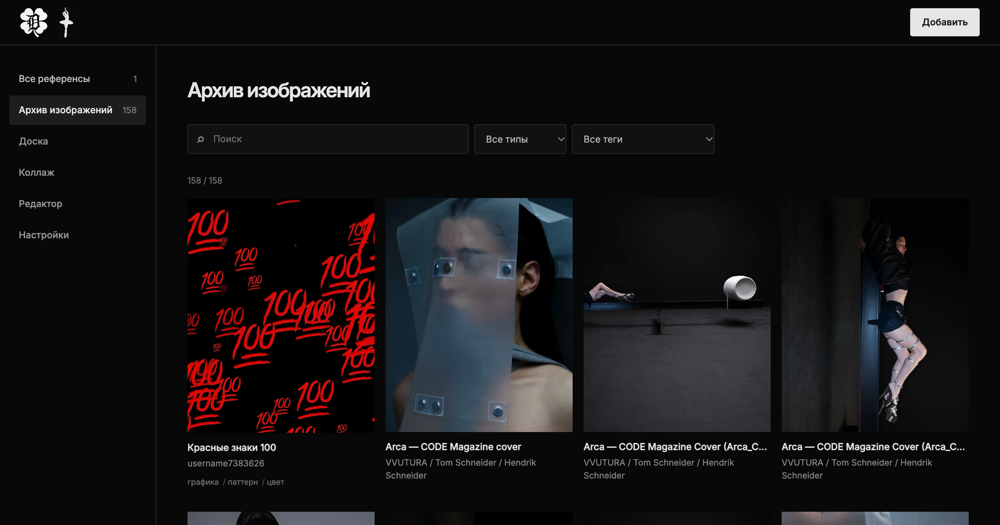
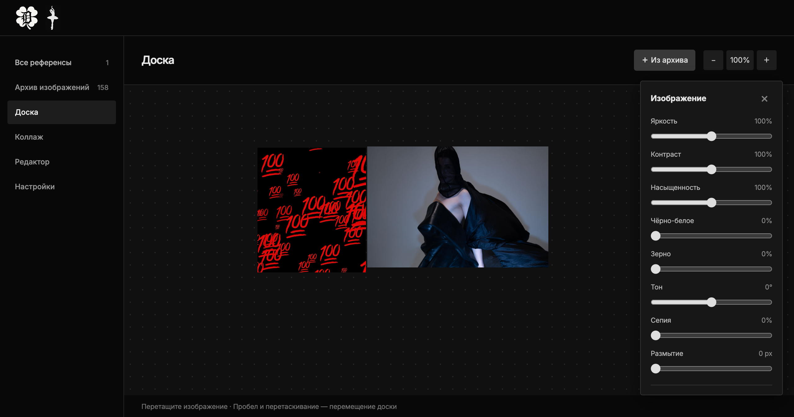
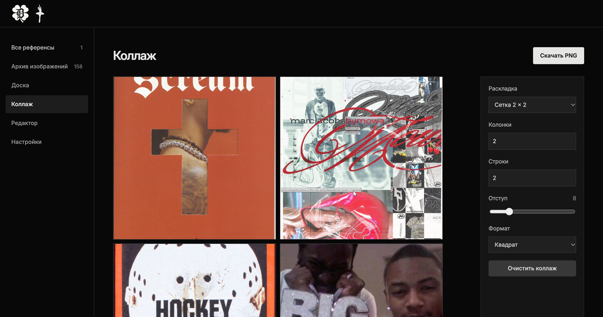
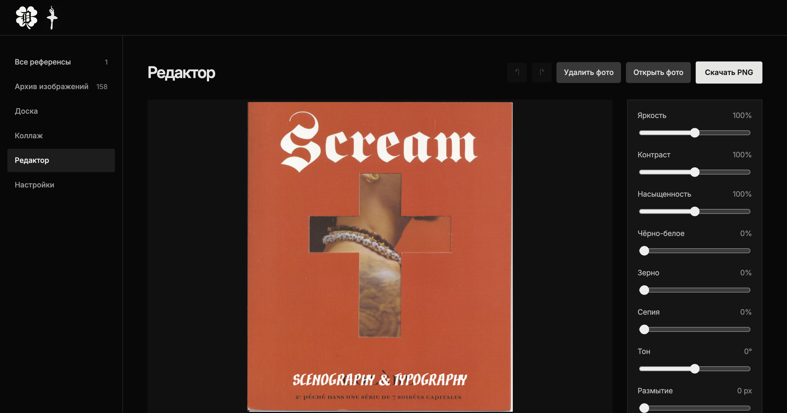
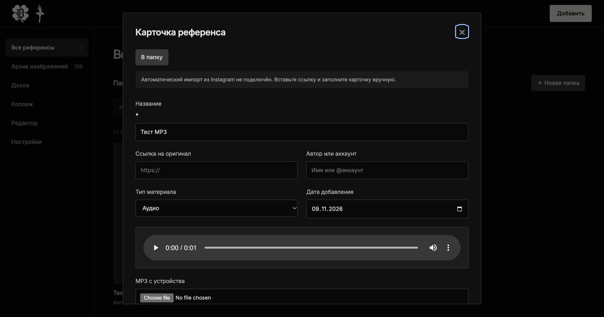
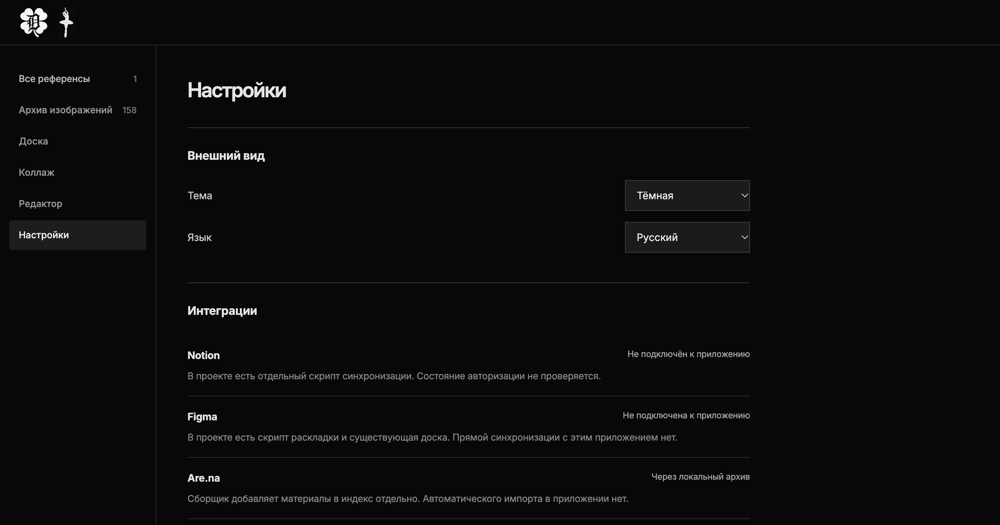

# Visual Reference Pipeline: Multi-Source → Notion → Figma


Автоматизированный пайплайн и автономное настольное веб-приложение для сбора, селекции и каталогизации дизайн-референсов. Связывает кураторский отбор в Instagram, Are.na и Pinterest, локальное интерактивное приложение (**Visual Reference App**), структурированную базу знаний в Notion и процедурную генерацию мудбордов в Figma.

---

## Скачать приложение (Download App)

Вы можете скачать готовое приложение со страницы **[GitHub Releases](https://github.com/therealfullmetal55555/visual-reference-pipeline/releases/latest)**:

* **[Visual-Reference-App-macOS.dmg](https://github.com/therealfullmetal55555/visual-reference-pipeline/releases/latest)** — нативный установщик для macOS (перетащите приложение в *Программы* / *Applications* и запускайте в один клик).
* **[Visual-Reference-App-macOS.zip](https://github.com/therealfullmetal55555/visual-reference-pipeline/releases/latest)** — готовый бандл `.app` с встроенным автозапуском и поддержкой Retina.
* **[Visual-Reference-App-Portable.zip](https://github.com/therealfullmetal55555/visual-reference-pipeline/releases/latest)** — портативная версия с однофайловыми лаунчерами `run.sh` (macOS/Linux) и `run.bat` (Windows).

---

## Возможности приложения (Visual Reference App)

1. **Медиатека и потоковый стриминг:**
   * Поддержка изображений, видео (MP4, WebM, MOV, OGV) и аудио (MP3) размером до 512 МБ.
   * Плавная перемотка и потоковое воспроизведение благодаря реализации HTTP 206 Range requests в локальном сервере.
   * Встроенные нативные плееры прямо внутри карточки просмотра.
2. **Интерактивная доска (Board):**
   * Размещение и свободная компоновка референсов на бесконечном холсте.
   * Неразрушающая коррекция (яркость, контраст, насыщенность, зерно, сепия, размытие, ч/б, кадрирование с 4 сторон).
   * Сохранение расстановки холста в локальную базу SQLite (`references.sqlite3`).
3. **Студия коллажей (Collage):**
   * Сетки от 1×1 до 6×6, готовые пресеты, Drag-and-Drop между слотами и экспорт в чистый PNG.
4. **Встроенный фоторедактор (Editor):**
   * Кадрирование, отражение, поворот на 90°.
   * Наложение текстовых надписей с акцидентными шрифтами (*Instrument Serif*, *Nighthawk*, *Westernic*, *Inter*).
   * Неограниченная история изменений Undo/Redo (`⌘+Z` / `⌘+Shift+Z`).
5. **Организация и персонализация:**
   * Создание локальных тематических папок без дублирования файлов на диске.
   * Тёмная и светлая темы, двуязычный интерфейс (RU / EN).

---

## Демонстрация интерфейса (UI Showcase)

### 1. Каталог и архив референсов (158 материалов)
Полнотекстовый поиск, мгновенная фильтрация по типам медиа (Фото, Видео, Аудио, Карусель), тегам и авторам. Карточки поддерживают отображение аудио-бейджей и видео-превью.



### 2. Интерактивная доска с неразрушающей коррекцией
Бесконечный холст для свободного позиционирования, масштабирования (25%–300%) и точечной поканальной настройки каждого кадра (яркость, контраст, ч/б, зерно, сепия, обрезка с 4 сторон).



### 3. Студия коллажей
Модульный конструктор с готовыми пропорциями (2×2, 3×3, 1+2, custom), поддержкой Drag-and-Drop и быстрым экспортом в высоком разрешении.



### 4. Встроенный фоторедактор и акцидентная типографика
Кадрирование, цветокоррекция и наложение надписей декоративными шрифтами (*Instrument Serif*, *Nighthawk*, *Westernic*, *Inter*) с историей отмены/повтора.



### 5. Потоковый медиаплеер (MP3 / MP4)
Встроенное воспроизведение аудио- и видео-исходников с поддержкой частичной загрузки (HTTP 206 Partial Content) и локальным кэшированием.



### 6. Панель настроек и системный промпт для ИИ-агента
Встроенная инструкция со всеми коннекторами (Notion DB, Notion Doc, Figma, GitHub, Brand Standards), переключением языков RU/EN и мгновенным копированием в буфер обмена для передачи агенту в Antigravity, Claude или ChatGPT.



---

## Архитектура решения

Пайплайн объединяет кураторский вкус человека и автоматизацию рутинных операций:

```text
[ Instagram, Are.na & Pinterest Channels ]
                  │
                  ▼  (Python Scrapers / CDN Upscalers)
[ Local High-Res Archive ] ──► archive_index.json (158 единиц)
                  │
                  ├──► [ Visual Reference App ] (Интерактивная доска, плееры, редактор)
                  │
                  ├──► [ Notion Database API ] (158 карточек, теги, фактологические заметки)
                  │
                  └──► [ Figma Canvas Engine ] (3-колоночная модульная сетка 2000×1650)
```

### 1. Кураторский отбор и мультиисточниковый сбор (Human-in-the-loop)
Человек определяет пул целевых профилей и кураторских каналов со специфической визуальной культурой (дизайн-исследования, сценография, типографика, концептуальная мода) и отбирает публикации под текущие задачи.

* **Instagram:** динамичный субкультурный контент, стрит-культура, сценография и бэкстейдж через извлечение чистых CDN-медиа без сжатия (`scripts/harvester.py`).
* **Are.na API:** прямая интеграция с исследовательской платформой Are.na для выгрузки несжатых сканов, редкой типографики и концептуальных арт-досок в оригинальном разрешении (`scripts/arena_harvester.py`).
* **Pinterest Harvester:** автоматическое извлечение сохранённых пинов и RSS-лент с автоматическим CDN-апскейлом превью (`236x`/`736x` → `1200x`) в несжатый high-res (`scripts/pinterest_harvester.py`).

### 2. Извлечение и локальный архив (Python)
* Скачивание исходных медиа в оригинальном разрешении без экранного сжатия.
* Формирование нормализованного локального архива (`images/Референсы/`).
* Генерация индексного манифеста `archive_index.json` со статусами и метаданными.
* Мгновенная доступность для локального приложения `reference_app`.

### 3. База знаний и разбор приёмов (Notion API)
* Автоматическое создание карточек через Notion REST API.
* Фиксация фактологических наблюдений (композиция, свет, типографика, материальность) вместо субъективных оценок.
* Разделение автора оригинальной работы и платформы/репостера.
* Учёт глубины изучения (*«Частично просмотрено»*, *«Только подпись»*, *«Только превью»*).

### 4. Процедурная раскладка на холсте (Figma API)
* Загрузка ассетов в рабочий файл через Figma API.
* Выполнение JavaScript-скрипта (Figma Plugin Engine):
  * Создание тёмных фреймов `2000×1650` (`#0E0E0E`) по категориям (*Fashion*, *Stage*, *Lettering*, *Graphic*).
  * Автоматический расчёт 3-колоночной модульной сетки.
  * Сохранение пропорций каждого изображения без искажений.
  * Генерация типографических подписей к каждому кадру.

---

## Текущие результаты

* **158 проверенных референсов (120 Instagram + 14 Are.na + 24 Pinterest)** синхронизированы между локальным хранилищем, приложением, базой Notion и файлом Figma.
* Время подготовки чистового презентационного мудборда сокращено с нескольких часов до **5 секунд**.
* Исключены пустые AI-галлюцинации и потеря ссылок на реальных авторов.

### Дополнительные визуальные материалы


---

## Стек технологий

* **Языки:** Python 3 (zero-dependency HTTP/SQLite server), JavaScript (ES6+ / Canvas API / Figma Plugin API).
* **Интеграции:** Notion REST API, Figma API, Chrome DevTools MCP, Are.na API, Pinterest CDN Engine.
* **Упаковка:** macOS .app bundle, Apple DMG (hdiutil), GitHub Actions CI/CD.

---

## Структура репозитория

```text
visual-reference-pipeline/
├── README.md
├── assets/
│   ├── visual-reference-workflow-cover-final.png  # Обложка репозитория с типографикой
│   ├── visual-reference-workflow-collage.png      # Коллаж визуальных материалов #1
│   ├── visual-reference-workflow-collage-3.png    # Коллаж визуальных материалов #2
│   ├── ui-archive-grid.png                        # Скриншот: Каталог и архив
│   ├── ui-board-canvas.png                        # Скриншот: Интерактивная доска
│   ├── ui-collage-studio.png                      # Скриншот: Студия коллажей
│   ├── ui-editor-typography.png                   # Скриншот: Фоторедактор с типографикой
│   ├── ui-media-modal.png                         # Скриншот: Медиаплеер и карточка
│   └── ui-settings-agent-prompt.png               # Скриншот: Настройки и системный промпт ИИ
├── reference_app/              # Локальное веб-приложение
│   ├── server.py               # HTTP/SQLite сервер с поддержкой Range-стриминга
│   ├── index.html              # Разметка интерактивного интерфейса
│   ├── style.css               # Стилистика (тёмная/светлая темы, канвас)
│   ├── app.js                  # Каталог, аудиоплеер, видеоплеер, теги
│   ├── board.js                # Интерактивная доска, зум, обрезка, фильтры
│   ├── studio.js               # Коллажирование и отдельный фоторедактор
│   ├── workspace.js            # Папки, темы, переключение языка RU/EN
│   └── fonts/                  # Акцидентные шрифты для оверлеев
├── scripts/
│   ├── harvester.py            # Извлечение оригинальных медиа из Instagram
│   ├── arena_harvester.py      # Are.na API → локальный архив
│   ├── pinterest_harvester.py  # Pinterest (RSS / JSON / CDN 1200px) → архив
│   ├── sync_notion.py          # Синхронизация манифеста с базой Notion API
│   ├── figma_layout.js         # Модульная авто-верстка сетки для Figma
│   └── package_app.py          # Автоматическая сборка macOS .app, DMG и Portable ZIP
├── tests/
│   ├── test_arena_harvester.py     # Unit-тесты для Are.na сборщика
│   └── test_pinterest_harvester.py # Unit-тесты для Pinterest сборщика
├── config/
│   └── categories.json         # Конфигурация категорий, префиксов и координат фреймов
└── docs/
    └── architecture.md         # Подробная архитектура и контракты данных
```

## Быстрый запуск

### 1. Запуск приложения из исходников
```bash
python3 reference_app/server.py
```
После запуска откройте в браузере: **`http://127.0.0.1:8765`**

### 2. Сборка настольного приложения (macOS .app / DMG)
```bash
python3 scripts/package_app.py
```
Готовые сборки сохраняются в папку `dist/`.

### 3. Сборщики референсов
```bash
# Instagram
python scripts/harvester.py --output ~/Desktop/instagram_archive/images/Референсы

# Are.na
python3 scripts/arena_harvester.py --channel minimal-typography

# Pinterest (из RSS или JSON)
python3 scripts/pinterest_harvester.py --rss "https://www.pinterest.com/username/board.rss"
```

### 4. Запуск тестов
```bash
python3 -m unittest discover -s tests
```

### 5. Синхронизация с Notion
```bash
export NOTION_API_KEY="your-secret-key"
python scripts/sync_notion.py --database-id "your-database-id"
```

### 6. Генерация раскладки в Figma
1. Откройте Figma Desktop с целевым файлом.
2. Нажмите **`⌥ + ⌘ + I`** (Option + Command + I) для открытия консоли.
3. Вставьте содержимое [`scripts/figma_layout.js`](scripts/figma_layout.js) и нажмите **Enter**.
