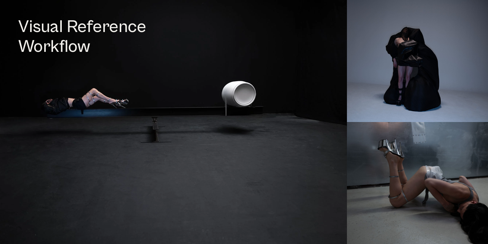
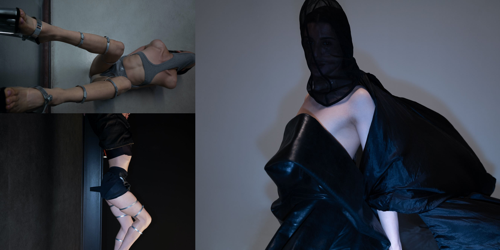
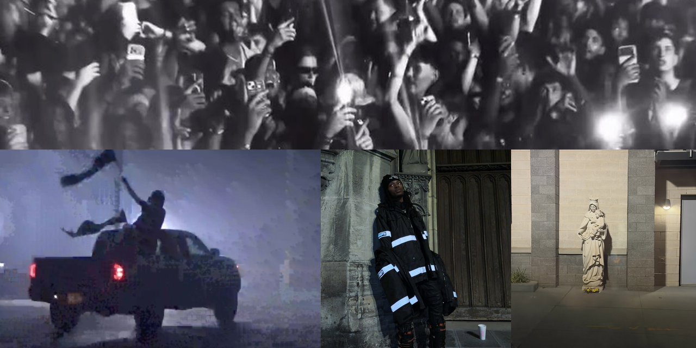

# Visual Reference Pipeline: Multi-Source → Notion → Figma



Автоматизированный пайплайн для сбора, селекции и каталогизации дизайн-референсов. Связывает кураторский отбор в Instagram, Are.na и Pinterest, структурированную базу знаний в Notion и процедурную генерацию мудбордов в Figma.

---

## Контекст и проблема

В работе над визуальным стилем (музыкальная графика, fashion-эдиториал, сценография, типографика) ключевую роль играет качество и систематизация референсов. Стандартный ручной процесс имеет три проблемы:
1. **Потеря качества:** скриншоты с экрана сжимают изображение и искажают детализацию.
2. **Утрата контекста:** в сохранённых постах теряется авторство (путаница между автором работы и аккаунтом-репостером) и конкретные приёмы.
3. **Рутина в Figma:** перетаскивание десятков картинок вручную отнимает часы и превращает доску в неструктурированный хаос.

## Архитектура решения

Пайплайн объединяет кураторский вкус человека и автоматизацию рутинных операций:

```text
[ Instagram, Are.na & Pinterest Channels ]
                  │
                  ▼  (Python Scrapers / CDN Upscalers)
[ Local High-Res Archive ] ──► archive_index.json (158 единиц)
                  │
                  ├──► [ Notion Database API ] (158 карточек, теги, фактологические заметки)
                  │
                  └──► [ Figma Canvas / Local Web App ] (3-колоночная сетка, холст 8765)
```

### 1. Кураторский отбор и мультиисточниковый сбор (Human-in-the-loop)
Человек определяет пул целевых профилей и кураторских каналов со специфической визуальной культурой (дизайн-исследования, сценография, типографика, концептуальная мода) и отбирает публикации под текущие задачи.

В систему заложена мультиисточниковая архитектура:
* **Instagram:** динамичный субкультурный контент, стрит-культура, сценография и бэкстейдж через извлечение чистых CDN-медиа без сжатия (`scripts/harvester.py`).
* **Are.na API:** прямая интеграция с исследовательской платформой Are.na для выгрузки несжатых сканов, редкой типографики и концептуальных арт-досок в оригинальном разрешении (`scripts/arena_harvester.py`).
* **Pinterest Harvester:** автоматическое извлечение сохранённых пинов и RSS-лент с автоматическим CDN-апскейлом превью (`236x`/`736x` → `1200x`) в несжатый high-res (`scripts/pinterest_harvester.py`).

### 2. Извлечение и локальный архив (Python)
* Скачивание исходных медиа в оригинальном разрешении без экранного сжатия.
* Формирование нормализованного локального архива (`images/Референсы/`).
* Генерация индексного манифеста `archive_index.json` со статусами и метаданными.
* Мгновенная доступность для локального веб-приложения (`reference_app` на порту 8765).

### 3. База знаний и разбор приёмов (Notion API)
* Автоматическое создание карточек через Notion REST API.
* Фиксация фактологических наблюдений (композиция, свет, типографика, материальность) вместо субъективных оценок.
* Разделение автора оригинальной работы и платформы/репостера.
* Учёт глубины изучения (*«Частично просмотрено»*, *«Только подпись»*, *«Только превью»*).

### 4. Процедурная раскладка на холсте (Figma API)
* Загрузка ассетов в рабочий файл через Figma API.
* Выполнение JavaScript-скрипта (Figma Plugin Engine):
  * Создание тёмных фреймов `2000×1650` (`#0E0E0E`) по категориям (*Fashion*, *Stage*, *Lettering*, *Graphic*).
  * Автоматический расчёт 3-колоночной модульной сетки.
  * Сохранение пропорций каждого изображения без искажений.
  * Генерация типографических подписей к каждому кадру.

---

## Текущие результаты

* **158 проверенных референсов (120 Instagram + 14 Are.na + 24 Pinterest)** синхронизированы между локальным хранилищем, базой Notion, локальным веб-приложением и файлом Figma.
* Время подготовки чистового презентационного мудборда сокращено с нескольких часов до **5 секунд**.
* Исключены пустые AI-галлюцинации и потеря ссылок на реальных авторов.

### Визуальные материалы и карта референсов





---

## Стек технологий

* **Языки:** Python 3, JavaScript (ES6+ / Figma Plugin API).
* **Интеграции:** Notion REST API, Figma API, Chrome DevTools MCP, Are.na API, Pinterest CDN Engine.
* **Хранилище:** Локальный JSON-индекс, SQLite базы приложения, реляционная база Notion.

---

## Структура репозитория

```text
visual-reference-pipeline/
├── README.md
├── assets/
│   ├── visual-reference-workflow-cover-final.png  # Обложка репозитория с типографикой
│   ├── visual-reference-workflow-collage.png      # Коллаж визуальных материалов #1
│   └── visual-reference-workflow-collage-3.png    # Коллаж визуальных материалов #2
├── scripts/
│   ├── harvester.py            # Извлечение оригинальных медиа из Instagram
│   ├── arena_harvester.py      # Are.na API → локальный архив
│   ├── pinterest_harvester.py  # Pinterest (RSS / JSON / CDN 1200px) → архив
│   ├── sync_notion.py          # Синхронизация манифеста с базой Notion API
│   └── figma_layout.js         # Модульная авто-верстка сетки для Figma
├── tests/
│   ├── test_arena_harvester.py     # Unit-тесты для Are.na сборщика
│   └── test_pinterest_harvester.py # Unit-тесты для Pinterest сборщика
├── config/
│   └── categories.json         # Конфигурация категорий, префиксов и координат фреймов
└── docs/
    └── architecture.md         # Подробная архитектура и контракты данных
```

## Быстрый запуск

### 1. Установка зависимостей
```bash
pip install -r requirements.txt
```

### 2. Запуск сборщика референсов (Instagram)
```bash
python scripts/harvester.py --output ~/Desktop/instagram_archive/images/Референсы
```

### 3. Сборщик Are.na → локальный архив
```bash
python3 scripts/arena_harvester.py --channel minimal-typography
```

Для закрытого канала передайте токен через окружение:
```bash
read -rs "ARENA_API_TOKEN?Токен Are.na: "
export ARENA_API_TOKEN
python3 scripts/arena_harvester.py --channel minimal-typography
unset ARENA_API_TOKEN
```

### 4. Сборщик Pinterest → локальный архив
Запуск с открытой RSS-ленты доски:
```bash
python3 scripts/pinterest_harvester.py --rss "https://www.pinterest.com/username/board.rss"
```

Или импорт структурированных пинов из сессии:
```bash
python3 scripts/pinterest_harvester.py --pins-json path/to/pins.json
```

### 5. Запуск тестов
```bash
python3 -m unittest discover -s tests
```

### 6. Синхронизация с Notion
```bash
export NOTION_API_KEY="your-secret-key"
python scripts/sync_notion.py --database-id "your-database-id"
```

### 7. Генерация раскладки в Figma
1. Откройте Figma Desktop с целевым файлом.
2. Нажмите **`⌥ + ⌘ + I`** (Option + Command + I) для открытия консоли.
3. Вставьте содержимое [`scripts/figma_layout.js`](scripts/figma_layout.js) и нажмите **Enter**.
