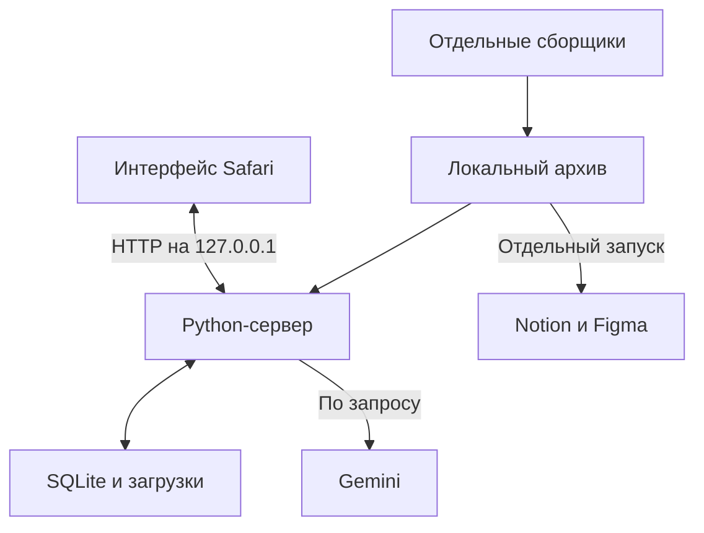

# Архитектура Visual Reference Workflow

## Основной поток данных

Веб-интерфейс работает на Vanilla JavaScript и Canvas API. Python-сервер обслуживает интерфейс, локальные медиа и JSON API. SQLite используется для пользовательских карточек, коллекций, состояния доски, документов рабочих сценариев и индекса признаков. Локальная папка исходников подключается независимо от папки данных приложения.

## Источники и хранение

| Источник | Формат и роль |
| --- | --- |
| `archive_index.json` | Массив объектов. Приложение читает `relative_path` или `local_path`, название, данные об авторе, исходную ссылку и теги. Путь должен относиться к `images/` или `videos/`. |
| `images/` и `videos/` | Исходники архива. Сервер проверяет, что запрошенный файл остаётся внутри соответствующей папки. Видео в `videos/` также обнаруживаются напрямую. |
| `references.sqlite3` | Собственные записи, коллекции, элементы доски, шот-листы, метки таймлайна, сохранённые сравнения, разборы Gemini и визуальные признаки. |
| `uploads/` | Пользовательские загрузки, сохранённые кадры и видеофрагменты. Исходный файл из внешнего архива при редактировании не меняется. |
| Настройки браузера | Тема, язык и состояние навигации. Настройки Safari для веб-приложения управляются отдельно. |

## Модули веб-интерфейса

- `app.js` — поиск по каталогу, фильтры, карточки, предпросмотр и выделение.
- `workspace.js` — коллекции, локальные настройки и интеграционные подсказки.
- `board.js` — холст доски, положение и оформление материалов, автосохранение и экспорт.
- `studio.js` — фоторедактор и редактор коллажей.
- `workflow.js` — шот-лист, таймлайн, сравнение, визуальный поиск и интерфейс Gemini.
- `workflow.py` — индекс признаков, сохранение документов сценариев, FFmpeg и запросы Gemini.

## HTTP API

| Маршрут | Назначение |
| --- | --- |
| `/api/archive`, `/api/references` | Записи внешнего архива и собственные карточки. |
| `/api/uploads`, `/archive/…`, `/media/…` | Загрузка и выдача медиа, включая частичную выдачу видео по HTTP Range. |
| `/api/folders`, `/api/board` | Коллекции и сохранение композиции доски. |
| `/api/workflow/{shots,timeline,comparisons,reviews}` | Чтение и сохранение документов сценариев. При обновлении проверяется ревизия документа. |
| `/api/workflow/{search,clip,review}` | Визуальный поиск, экспорт видеофрагментов и разбор выбранных кадров. |

Визуальный поиск сравнивает измеримые признаки изображений и использует метаданные для текстовых совпадений. Видеофрагменты до 60 секунд обрабатываются локальным FFmpeg. Gemini — отдельный, запускаемый пользователем сетевой шаг.

Дополнительная версия на SwiftUI переиспользует Python-движок через локальный обмен по stdin/stdout. Основная версия для Safari использует HTTP и запускается командой из README.
