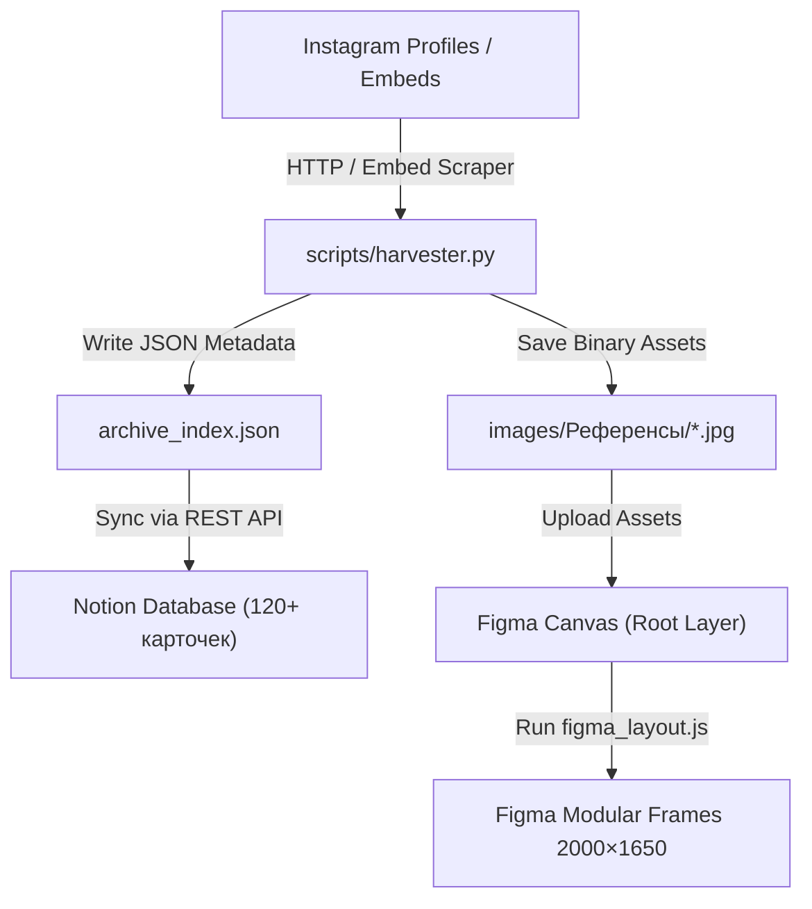

# Архитектура Visual Reference Pipeline

Инженерный документ, описывающий структуру данных, контракты взаимодействия и принципы работы системы.

## Принципы проектирования

1. **Human-in-the-loop (Человек во главе процесса):**  
   Алгоритмы не выбирают, что красиво или модно. Выбор персоналий, брендов и конкретных постов остаётся исключительно за креатором. Система берёт на себя техническую рутину: скачивание оригиналов, нормализацию, ведение базы данных и верстку.
2. **Истинное разрешение (Zero Quality Degradation):**  
   Никаких скриншотов с экрана. Парсинг структуры Instagram Embed позволяет извлечь прямой URL файла из CDN (`scontent.cdninstagram.com`) в исходном разрешении до 1440px по длинной стороне.
3. **Разделение автора и репостера:**  
   В современной визуальной среде большинство профилей — это агрегаторы (мудборд-аккаунты). Система требует явного разделения: кто опубликовал и кто создал.
4. **Фактологические наблюдения вместо клише:**  
   Вместо оценочных суждений («красиво», «атмосферно», «мрачно») фиксируются измеримые параметры: контраст, композиция, световые схемы, пластика шрифта, материальность.

---

## Потоки данных (Data Flow)

## Спецификация схемы карточки (Notion & JSON)

Каждая запись в каталоге описывается контрактом:

| Поле | Тип | Назначение |
|---|---|---|
| `Название` | `title` | Идентификатор работы на русском языке |
| `Автор` | `text` | Никнейм или имя создателя / фотографа / дизайнера |
| `Ссылка` | `url` | Канонический URL оригинальной публикации |
| `Категория` | `select` | Направление работы (`Исследовать`, `В продакшн`) |
| `Формат` | `select` | `Пост`, `Reel`, `Карусель` |
| `Просмотр` | `select` | Глубина изучения (`Частично просмотрено`, `Полностью просмотрено`) |
| `Медиа` | `text` | Относительный путь к файлу в локальном архиве |
| `Наблюдение` | `text` | Фактологическое описание визуального приёма |
| `Теги` | `multi_select` | Ключевые слова (фотография, свет, леттеринг, сценография и др.) |

---

## Верстка в Figma

Фреймы формируются по стандарту:
* **Размер:** `2000 × 1650 px`
* **Фон:** `#0E0E0E` (Solid Dark)
* **Сетка:** 3 колонки, ширина карточки `560 px`, межколоночный интервал `60 px`, вертикальный интервал `80 px`.
* **Типографика:** Заголовок секции — `Inter Medium 24px` (`#E6E6E6`), подписи к кадрам — `Inter Regular 14px` (`#999999`).
